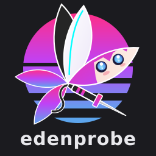

# edenprobe
<p align="center">
  <br>
  <b>Wimsy as edenprobe</b>
</p>

A test program for the console and its emulators. Every case works out the answer it expects, checks the one it
got, and writes it to a report that can be compared between two machines: a console and an emulator, or two
builds of one emulator. No case needs a person to look at the screen.

## Quick start

The newest nightly is
[edenprobe.nro](https://github.com/scarletnx/edenprobe/releases/download/nightly/edenprobe.nro), and each version has
a [release](https://github.com/scarletnx/edenprobe/releases).

- On a console: put it in the SD card's `switch/` folder and open it from the homebrew menu.
- In an emulator: open the NRO.
- On Android, or ScarletNX's Android layer: the APK, `android/` ([On Android](docs/Android.md)), the same engine
  with Android's own cases beside the ones every machine runs.

Without a mode file the start screen asks what to run; `sdmc:/edenprobe/mode` chooses instead
([Mode file](docs/ModeFile.md)): `quick all` runs every family that needs nobody, all but pad and nvn. Naming a family
runs that family alone. nvn's window case runs only in a quick run from the mode file, never in one begun on the start
screen, `noprogress` or not. The report goes to `sdmc:/edenprobe/runs/<build>/report.jsonl`
([Report](docs/Report.md)).

## Build

With devkitPro in `/opt/devkitpro`:

```sh
export DEVKITPRO=/opt/devkitpro
make                                  # edenprobe.nro
make -f host.mk host-run              # the judge and the tools' tests, on this machine
gradle -p android assembleDebug       # the APK, with ANDROID_HOME and a JDK 17 or newer
make run EMULATOR=/path/to/emulator   # a quick run, started again after a crash
```

See [Build](docs/Build.md), [Running it under an emulator](docs/Emulator.md),
[Running it on Android](docs/Android.md) and [Frontends](docs/Frontends.md). Every document: [docs](docs/README.md).

## Credits

edenprobe follows switch-examples and builds on libnx and deko3d; what comes from each, and from the other
projects it uses, is in [Credits](docs/Credits.md). Wimsy, ScarletNX's mascot, was drawn by Liz.

## Licence

GPL-3.0-or-later; the full text is in `LICENSE`.
